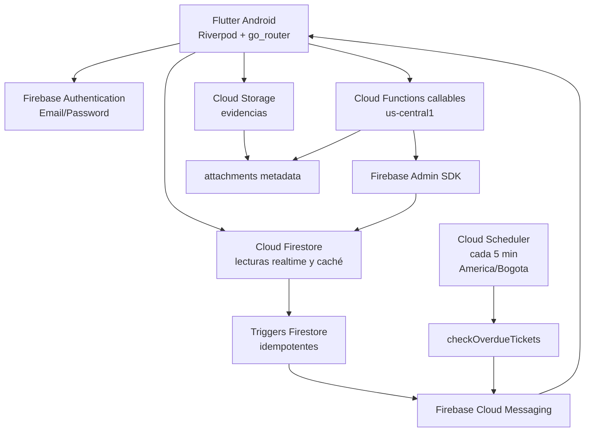
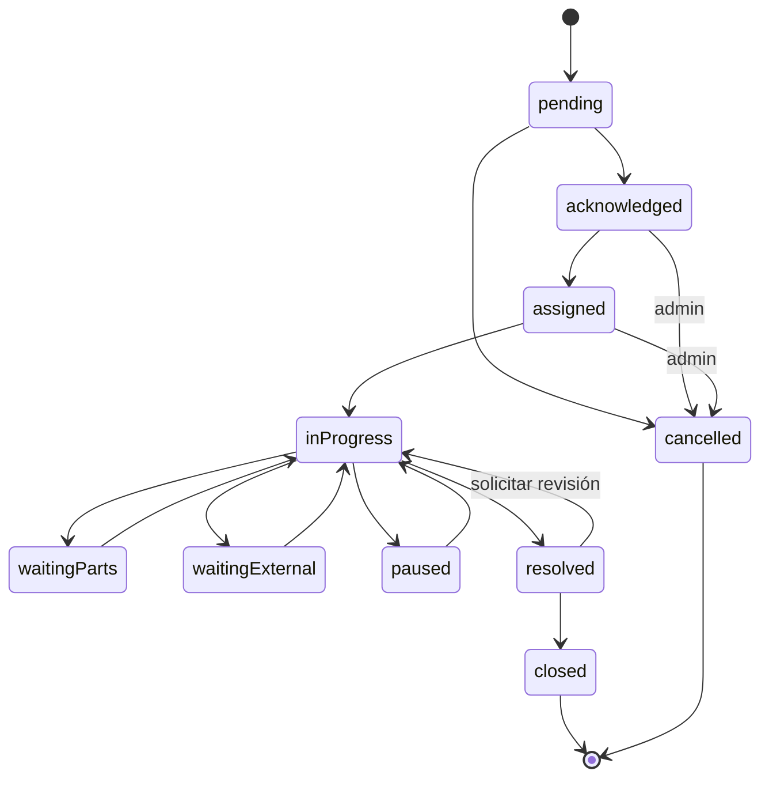

# Arquitectura técnica

## Objetivos que gobiernan el diseño

Gestión Interna se diseñó alrededor de tres prioridades, en este orden:

1. El cambio de un ticket debe generar una notificación Android útil y dirigida a la persona correcta.
2. Un dato crítico nunca se reemplaza sin dejar un evento de auditoría.
3. Mantenimiento es el primer módulo, no una limitación permanente de la aplicación.

La app móvil es un cliente no confiable. Puede presentar formularios y ocultar acciones según rol, pero las decisiones de seguridad, código humano, transiciones, asignaciones, prioridad y escalamiento se vuelven a validar en Cloud Functions y Security Rules.

## Vista general



Flujo principal:

```text
Flutter
  -> Authentication identifica al usuario
  -> users/{uid} define rol, área y estado activo
  -> callable valida la acción y escribe ticket + evento
  -> trigger observa el cambio y reclama notification_jobs/{eventId}
  -> Admin SDK resuelve destinatarios y sus dispositivos
  -> FCM envía payload con ticketId + route
  -> Android muestra canal normal/urgente
  -> go_router abre /maintenance/tickets/:ticketId
```

## Componentes Flutter

La estructura evita concentrar negocio, Firebase y widgets en `main.dart`:

```text
lib/
  main.dart                         arranque y ProviderScope
  app/
    router.dart                     rutas, guardas y deep links
    theme/                          Material 3, claro/oscuro
  config/
    app_config.dart                 IDs, región, límites y dart-defines
  core/
    errors/                         errores comprensibles
    firebase/                       bootstrap real/emulador y providers
    notifications/                  FCM, canales y navegación por ticket
    utils/                          fechas y conversión Firestore
  features/
    auth/
      application/                  providers de sesión/perfil
      data/                         AuthRepository y UserRepository
      domain/                       AppUser/UserRole
      presentation/                 login y recuperación
    home/                           selector extensible de módulos
    maintenance/
      application/                  Riverpod y coordinación de casos de uso
      data/                         repositorio, Functions, Storage
      domain/                       modelos y reglas puras
      presentation/                 dashboard, formularios y detalle
  shared/
    widgets/                        badges y estados async reutilizables
```

### Estado

Se usa Riverpod de manera consistente:

- El stream de Firebase Auth determina sesión.
- `users/{uid}` determina perfil activo y rol.
- Providers por ticket/lista exponen `AsyncValue`, incluyendo loading/error/empty.
- Repositorios se inyectan; los widgets no construyen instancias Admin ni escriben lógica de permisos.
- Reglas puras como prioridad y transiciones pueden probarse sin Flutter/Firebase.

### Navegación

`go_router` protege rutas según sesión y perfil activo. La ruta canónica del detalle es:

```text
/maintenance/tickets/:ticketId
```

El payload FCM contiene:

```text
ticketId=<id Firestore>
route=/maintenance/tickets/<id Firestore>
```

`NotificationService` amortigua IDs recibidos antes de que el router esté escuchando, cubriendo el arranque terminated. El router vuelve a verificar permisos al leer el ticket; conocer una ruta no concede acceso.

### Configuración de entorno

`AppConfig` centraliza:

```text
applicationId             com.samuelpararia.gestioninterna
functionsRegion           us-central1
demoProjectId             demo-gestion-interna
USE_FIREBASE_EMULATORS     false por defecto
FIREBASE_EMULATOR_HOST     10.0.2.2 por defecto
maxPhotosPerTicket         5
maxPhotoBytes              5 MiB
ticketPageSize             100
```

En modo emulador, `FirebaseBootstrap` inicializa un demo project y conecta Auth 9099, Firestore 8080, Functions 5001 y Storage 9199. En modo real usa únicamente `DefaultFirebaseOptions.currentPlatform` generado por FlutterFire.

## Modelo de seguridad

La autorización tiene tres capas complementarias:

1. **UI:** evita mostrar acciones imposibles y explica por qué.
2. **Security Rules:** bloquea lecturas/escrituras directas fuera del alcance.
3. **Cloud Functions:** vuelve a cargar el perfil, deriva el actor y valida cada mutación privilegiada.

App Check puede añadir evidencia de que la petición proviene de una app legítima; no reemplaza ninguna de las capas anteriores.

### Roles exactos

| Rol persistido | Alcance principal |
|---|---|
| `production` | Crear solicitudes para su área, ver sus tickets, actualizar parada/reanudación, comentar, adjuntar, escalar, cancelar mientras está pendiente, cerrar o reabrir una resolución. |
| `maintenance` | Ver tickets destinados a su área, reconocer, asignar, ejecutar flujo de trabajo, comentar, adjuntar diagnóstico/evidencia y resolver. |
| `admin` | Supervisión global y acciones excepcionales auditadas; usuarios/catálogos se gestionan con scripts administrativos. |

El documento `users/{uid}` es la autoridad de aplicación:

| Campo | Tipo/uso |
|---|---|
| `uid` | Debe coincidir con Firebase Auth. |
| `name`, `email` | Snapshot de identidad visible. |
| `role` | Uno de los tres valores exactos. |
| `departmentId` | Área que delimita consultas/permisos. |
| `active` | Un usuario inactivo se rechaza aunque conserve sesión Auth. |
| `createdAt`, `updatedAt` | Timestamps de servidor/administración. |

Un usuario normal nunca puede cambiar `role`, `departmentId`, `active` o UID. Los perfiles se administran con script/entorno confiable.

## Estructura Firestore

```text
users/{uid}
  devices/{deviceId}

departments/{id}
modules/{id}
assets/{id}
ticket_categories/{id}
form_templates/{id}
settings/maintenance
counters/{module-date}

tickets/{ticketId}
  comments/{commentId}
  events/{eventId}
  attachments/{attachmentId}

_command_receipts/{id}            solo backend
notification_jobs/{eventId}       solo backend
device_installations/{id}         solo backend; índice de propiedad
device_tokens/{tokenHash}         solo backend; índice de propiedad
```

### Catálogos

- `departments`: áreas actuales y futuras. Seed: `production`, `maintenance`.
- `modules`: tarjeta/ruta/estado de cada módulo. Seed: `maintenance`.
- `assets`: `name`, `code`, `departmentId`, `location`, `critical`, `active`. Seed: Columbia 21 crítica.
- `ticket_categories`: categorías activas ordenables, no listas duplicadas en pantallas.
- `form_templates`: preguntas adicionales versionadas por módulo.
- `settings/maintenance`: SLA operativo, cooldown, fotos y política de prioridad.

Desactivar un catálogo mantiene la referencia histórica; no se debe borrar un activo que ya aparece en tickets.

### `tickets/{ticketId}`

El documento principal contiene los campos necesarios para filtros/listados sin leer todas las subcolecciones. Grupos relevantes:

**Identidad y origen**

```text
schemaVersion, moduleId, humanCode
title, description, categoryId, location
sourceDepartmentId, targetDepartmentId
requesterUid, requesterName, requesterEmail, createdByUid
```

**Activo e impacto**

```text
assetId, assetSnapshot
productionStopped, productionStoppedAt, productionResumedAt
safetyRisk, impactPercentage, impactNotes
```

`assetSnapshot` conserva nombre/código/ubicación/criticidad existentes al crear el ticket aunque el catálogo cambie después.

`productionStoppedAt` se fija al crear si ya existe parada y se actualiza al reportar una nueva parada. `productionResumedAt` se fija al confirmar reanudación y vuelve a `null` ante una parada posterior. Solo el solicitante de Producción o un administrador puede usar `updateProductionImpact` mientras el ticket siga abierto; el motivo es obligatorio y `productionImpactChanged` conserva cada cambio histórico. El cliente nunca escribe estos campos directamente.

**Formulario dinámico**

```text
formTemplateId, formTemplateVersion, formResponses
```

Se conserva versión para interpretar respuestas históricas después de editar una plantilla.

**Prioridad trazable**

```text
suggestedPriority, priorityScore, priorityPolicyVersion, priorityFactors
priority, priorityRank, prioritySetByUid, prioritySetAt
priorityOverrideReason
```

La prioridad sugerida y la elegida no se mezclan. Al crear, elegir un nivel menor que el sugerido exige `priorityOverrideReason`; aumentarlo no lo exige. Un cambio posterior usa `updatePriority`, siempre exige motivo y registra `priorityChanged` con actor/antes/después.

**Estado/asignación**

```text
status, isOpen, statusChangedAt
primaryAssigneeUid, primaryAssigneeName
participantUids, assignedByUid, assignedAt, lastAssignedAt
```

**Tiempos y resolución**

```text
acknowledgedByUid, acknowledgedAt
workStartedAt, lastWorkResumedAt
diagnosis, workPerformed, resolutionNotes
resolvedByUid, resolvedAt, lastResolvedAt, resolutionAttemptCount
reopenCount, lastReopenedAt
closedByUid, closedAt
cancelledByUid, cancelledAt, cancellationReason
waitingReason, waitingSince
```

**Escalamiento**

```text
escalationCount, manualEscalationCount
lastManualEscalationAt, lastAutomaticEscalationAt
automaticEscalationLevel, nextAutomaticEscalationAt
lastEscalationType, lastEscalationReason
```

**Operación**

```text
attachmentCount, searchTokens
createdAt, updatedAt, lastActivityAt, lastMutation
```

Los timestamps críticos se escriben con reloj de servidor. `America/Bogota` solo se usa para presentación, código diario y Scheduler; Firestore Timestamp permanece absoluto/UTC.

### Comentarios

Ruta:

```text
tickets/{ticketId}/comments/{commentId}
```

Cada comentario almacena texto, UID/nombre/rol del actor y `createdAt`. Se crea mediante `addComment`; el backend toma actor de Auth/perfil y no confía en un nombre enviado por el cliente. `onCommentCreated` notifica participantes salvo el autor.

### Auditoría inmutable

Ruta:

```text
tickets/{ticketId}/events/{eventId}
```

Contrato:

```text
type
actorUid
actorName
actorRole
createdAt
previousValue
newValue
message
metadata
correlationId
source = callable | trigger | scheduler
```

Los clientes pueden leer eventos dentro de su alcance, pero no crearlos, editarlos ni borrarlos directamente. Cada mutación importante y su evento se escriben en una transacción/batch cuando la consistencia lo exige.

Tipos persistidos principales: `ticketCreated`, `ticketAcknowledged`, `assignmentChanged`, `workStarted`, `workResumed`, `ticketWaiting`, `ticketPaused`, `statusChanged`, `priorityChanged`, `productionImpactChanged`, `commentAdded`, `attachmentAdded`, `manualEscalation`, `automaticEscalation`, `ticketResolved`, `ticketClosed`, `ticketReopened` y `ticketCancelled`.

### Adjuntos

El objeto binario está en Storage:

```text
tickets/{ticketId}/{attachmentId}/{fileName}
```

El documento Firestore está en:

```text
tickets/{ticketId}/attachments/{attachmentId}
```

El cliente genera `attachmentId`, reduce la captura/selección a un máximo aproximado de 1600×1600 con calidad 75 cuando el codec lo permite, aplica un límite duro de 5 MiB y carga a la ruta exclusiva. La metadata Storage incluye `ticketId`, `attachmentId` y `uploaderUid`; Rules exige que este último coincida con `request.auth.uid`. Después llama `registerAttachment`, cuya Function vuelve a comprobar ticket, participante, ruta, content type y bytes antes de registrar metadata/auditoría. HEIC y otros formatos pueden conservar comportamiento propio del sistema; el límite de bytes sigue siendo la barrera definitiva. Si falla el registro, el cliente intenta borrar el objeto huérfano: Storage Rules solo permiten al mismo `uploaderUid` borrarlo mientras no exista el documento `attachments/{attachmentId}`. Una vez registrado, el objeto queda inmutable como evidencia auditada.

### Dispositivos

Ruta:

```text
users/{uid}/devices/{deviceId}
```

`deviceId` es un UUID de instalación local estable guardado en preferencias; no es el token FCM ni debe confundirse con el Firebase Installation ID oficial. El documento contiene `installationId`, `token`, `platform=android`, `applicationId`, permiso de notificación, timestamps y `lastSeenAt`.

Flutter invoca `registerDevice`/`unregisterDevice`; las Rules niegan escrituras directas incluso al dueño. El backend mantiene índices privados `device_installations/{installationId}` y `device_tokens/{tokenHash}` y, dentro de transacción, retira asociaciones anteriores antes de asignar una instalación/token a la cuenta autenticada. Así se evita que un teléfono compartido siga asociado a dos usuarios.

Ventajas:

- Un usuario puede tener varios teléfonos.
- Renovar el token actualiza el mismo documento.
- Logout intenta retirar solo esa instalación antes de cerrar Auth; un fallo de red no impide cerrar y puede dejar el registro hasta que se reclame de nuevo o FCM lo invalide.
- El backend puede desactivar/eliminar un token inválido sin afectar otros dispositivos.

FCM está migrando a FIDs en 2026; el acceso queda encapsulado en NotificationService/repositorio para migrar sin alterar tickets o usuarios.

### Contadores y código humano

`counters/{module-date}` se actualiza mediante transacción del backend. Para Mantenimiento, el resultado sigue la forma:

```text
MTTO-YYYYMMDD-NNNN
```

La transacción serializa incrementos concurrentes; Firestore genera además el ID interno no predecible. El cliente nunca calcula el consecutivo definitivo.

### Trabajos de notificación

`notification_jobs/{eventId}` es interno del backend. Reclamar el ID del evento antes de enviar permite distinguir entrega duplicada de Firestore de una acción nueva. El cliente no tiene acceso a esta colección.

`_command_receipts/{id}` cumple una función distinta: recuerda el resultado de `createTicket` identificado por su `requestId` (la clave de idempotencia). Si Android reintenta por timeout con el mismo valor, el backend devuelve el ticket ya creado en vez de consumir otro consecutivo. También es backend-only. Las demás callables reutilizan `requestId` para derivar un ID de evento determinista y detectar el mismo comando repetido dentro del ticket.

## Formularios dinámicos

`form_templates/{id}` incluye `moduleId`, `version`, `active` y `fields`. Cada campo tiene `id`, `type`, `label`, `helpText`, `required`, `order` y `options` cuando corresponde.

Tipos persistidos:

```text
shortText
longText
number
yesNo
singleChoice
multipleChoice
checklist
date
photo
```

Los campos estructurados críticos —producción detenida, riesgo, prioridad, ubicación, activo— permanecen fuera del formulario dinámico para poder consultar, proteger y analizar consistentemente. Las preguntas dinámicas complementan, no reemplazan, ese núcleo.

## Política de prioridad

La regla es operativa/configurable, no una norma industrial. La configuración demo asigna:

| Factor | Puntos demo |
|---|---:|
| Riesgo para personas/equipos | 7 |
| Producción detenida | 5 |
| Activo crítico | 2 |
| Afectación desde 25 % | 1 |
| Afectación desde 75 % | 2 |

Umbrales demo: media desde 2, alta desde 5 y crítica desde 7. Riesgo de seguridad fuerza como mínimo crítica; producción detenida + activo crítico también. `settings/maintenance.priorityPolicy` versiona pesos/umbrales. El backend recalcula y no acepta ciegamente score/factores del celular.

## Máquina de estados



| Persistido | UI | Quién normalmente ejecuta |
|---|---|---|
| `pending` | Pendiente | Estado inicial. |
| `acknowledged` | Recibido | Mantenimiento del área. |
| `assigned` | Asignado | Mantenimiento/admin. |
| `inProgress` | En proceso | Responsable/participante asignado. |
| `waitingParts` | En espera de repuesto | Responsable asignado; motivo obligatorio. |
| `waitingExternal` | En espera externa | Responsable asignado; motivo obligatorio. |
| `paused` | Pausado | Responsable asignado; motivo obligatorio. |
| `resolved` | Resuelto | Mantenimiento con diagnóstico/trabajo/observación. |
| `closed` | Cerrado | Solicitante confirma o admin. |
| `cancelled` | Cancelado | Solicitante solo desde pendiente; admin excepcional. |

Desde `resolved`, el solicitante puede volver a `inProgress`; aumenta `reopenCount` y registra `ticketReopened`. `closed` y `cancelled` son terminales. Ni cliente, Rules ni Function permiten saltos arbitrarios.

## Callables y frontera de escritura

| Callable | Datos clave | Garantías |
|---|---|---|
| `createTicket` | formulario + `requestId` | Usuario activo, catálogos válidos, prioridad recalculada, contador transaccional, evento `ticketCreated`. |
| `transitionTicket` | `ticketId`, `toStatus`, campos de resolución/motivo, `requestId` | Grafo + rol/relación, campos obligatorios, timestamps y auditoría. |
| `assignTicket` | `ticketId`, `primaryAssigneeUid`, `participantUids`, `requestId` | Roles activos de mantenimiento, límites, snapshots y evento. |
| `addComment` | `ticketId`, `text`, `requestId` | Participante autorizado, texto limitado, actor derivado. |
| `updatePriority` | `ticketId`, `priority`, `reason`, `requestId` | Autorización, razón, antes/después y evento. |
| `updateProductionImpact` | `ticketId`, `productionStopped`, `reason`, `requestId` | Solicitante/admin, ticket abierto, cambio real, timestamps y evento. |
| `registerAttachment` | `ticketId`, identidad/ruta del objeto, atributos de imagen, `requestId` | Ruta exacta, objeto válido, límite y metadata. |
| `escalateTicket` | `ticketId`, motivo opcional, `requestId` | Ticket abierto, rol permitido, cooldown, incremento y alerta urgente. |
| `registerDevice` | instalación, token, app/plataforma, permiso y fecha local | Perfil activo, esquema, dueño único y timestamps de servidor. |
| `unregisterDevice` | `installationId` | Auth obligatoria y borrado transaccional del device doc/índices propios. |

La única escritura directa excepcional es el objeto Storage autorizado. Device docs y todas las mutaciones de negocio pasan por callables; los clientes leen datos dentro del alcance de Rules.

## Notificaciones

### Eventos

- Ticket nuevo: usuarios activos de Mantenimiento en el área destino.
- Recibido/asignado/cambio de estado/prioridad: participantes y solicitante según contexto.
- Parada/reanudación de producción: participantes, Mantenimiento del área y, salvo exclusión del actor, solicitante; una nueva parada usa canal urgente.
- Comentario: participantes salvo autor.
- Resuelto: solicitante para confirmar.
- Cerrado: participantes.
- Escalamiento manual/automático: mantenimiento del área destino y administradores; canal urgente.

### Selección de destinatarios

1. Resolver usuarios activos por área/participación.
2. Excluir `actorUid` cuando no tiene sentido auto-notificar.
3. Obtener sus device docs y conservar únicamente `notificationsEnabled == true` con permiso/token válidos.
4. Quitar tokens repetidos o vacíos.
5. Enviar en lotes compatibles con Admin SDK.
6. Eliminar/desactivar registros inválidos preservando los demás dispositivos.

### Canales Android estables

```text
gestion_interna_normal_v1
gestion_interna_urgent_v1
```

El urgente tiene importancia máxima, sonido y vibración. Un ID de canal nunca se reutiliza con otra semántica porque Android conserva la preferencia creada.

### Fiabilidad realista

FCM es una señal de aviso, no la fuente de verdad. Sin Internet, con permiso denegado o tras Force stop, no se puede prometer entrega inmediata. Al abrir/reconectar, la app consulta Firestore y refleja el estado real. High priority solo se usa cuando hay contenido visible urgente para evitar degradación por FCM.

## Escalamiento automático

`checkOverdueTickets` se ejecuta cada cinco minutos, zona `America/Bogota`. Primero lee `automaticEscalationEnabled`; si está apagado, no consulta candidatos. No recorre toda la colección: consulta hasta 100 tickets abiertos con `nextAutomaticEscalationAt <= now`, respaldada por índice. Para cada candidato, dentro de transacción vuelve a confirmar:

- Estado `pending`, abierto y aún no reconocido.
- Prioridad alta/crítica aplicable.
- Vencimiento todavía alcanzado.
- No fue escalado ya para ese vencimiento/nivel (ID de evento determinista).

Actualiza `lastAutomaticEscalationAt`, nivel y próximo vencimiento, crea evento y deja que el trigger reclame el trabajo de notificación idempotente. El máximo configurado decide si se agenda otra repetición; al reconocer el ticket se limpia el vencimiento, evitando alertas posteriores por falta de reconocimiento.

Valores demo configurables en `settings/maintenance`:

```text
criticalAcknowledgementMinutes = 30
highAcknowledgementMinutes = 120
manualEscalationCooldownMinutes = 15
automaticEscalationRepeatMinutes = 30
maximumAutomaticEscalationLevel = 3
automaticEscalationEnabled = true
maxPhotosPerTicket = 5
maxPhotoBytes = 5242880
```

## Consultas, índices y tiempo real

- Admin: tickets por `updatedAt`, limitados.
- Producción: `requesterUid == uid`, orden por `updatedAt`.
- Mantenimiento: `targetDepartmentId == departmentId`, orden por `updatedAt`.
- Activos: `active == true`, orden por nombre.
- Plantilla: módulo + activa, versión descendente.
- Comentarios/eventos/attachments: subcolección del ticket, con límites.
- Scheduler: candidatos por `isOpen` y `nextAutomaticEscalationAt`; estado y prioridad se vuelven a validar en la transacción.

Los índices compuestos están en `firestore.indexes.json`. La lista inicial limita 100 tickets; comentarios/eventos limitan 200 y attachments 50. Para crecimiento real se debe sustituir el límite fijo por paginación con cursores, no offsets.

## Offline y consistencia

Firestore Android mantiene caché y sincroniza streams al reconectar. El dashboard/listado deriva el banner **Datos locales/cache** de `QuerySnapshot.metadata.isFromCache`; indica procedencia del snapshot, no conectividad física perfecta. La UI también distingue operaciones en curso. Sin embargo:

- Las callables requieren red y confirmación de servidor; no se presenta éxito antes de la respuesta.
- Una carga de Storage requiere red y puede dejar un objeto huérfano si la caída ocurre entre upload/registro; existe limpieza de mejor esfuerzo y debe monitorearse.
- FCM no entrega sin conectividad.
- Las transacciones de contador/auditoría ocurren en backend, no en una cola local insegura.

## Extensión a otras áreas

Para agregar Calidad, Laboratorio o Logística:

1. Crear `departments` y `modules` nuevos.
2. Añadir categorías, activos y plantilla versionada.
3. Implementar feature/presentación y políticas específicas sin modificar el núcleo Auth/notificaciones.
4. Añadir callables/reglas e índices explícitos para el nuevo flujo.
5. Mantener `moduleId`, departamentos y snapshots en documentos para análisis cruzado.

No se debe copiar el módulo Mantenimiento y reemplazar cadenas dispersas. IDs, rutas, permisos y branding se centralizan.

## Decisiones y limitaciones conscientes del MVP

- Solo Android; no se registran plataformas innecesarias.
- Email/Password; no Google/Phone login.
- Búsqueda por código/título/equipo mediante tokens normalizados, no motor full-text.
- Catálogos y formularios se administran mediante seed/Firestore; no hay constructor visual avanzado.
- FCM real necesita Blaze indirectamente por Functions, aunque FCM sea gratuito.
- Storage/Functions reales exigen Blaze; Emulator Suite cubre desarrollo.
- El máximo inicial es cinco fotos de 5 MiB por ticket; se debe mantener sincronizado entre Flutter, settings, Function y Rules.
- `notification_jobs` evita duplicados de procesamiento, pero FCM sigue sujeto a condiciones del dispositivo/red.

Para operar el proyecto consulte [FIREBASE_SETUP.md](FIREBASE_SETUP.md); para costos y límites, [FIREBASE_COSTS.md](FIREBASE_COSTS.md); para escenarios de verificación, [TESTING.md](TESTING.md).
